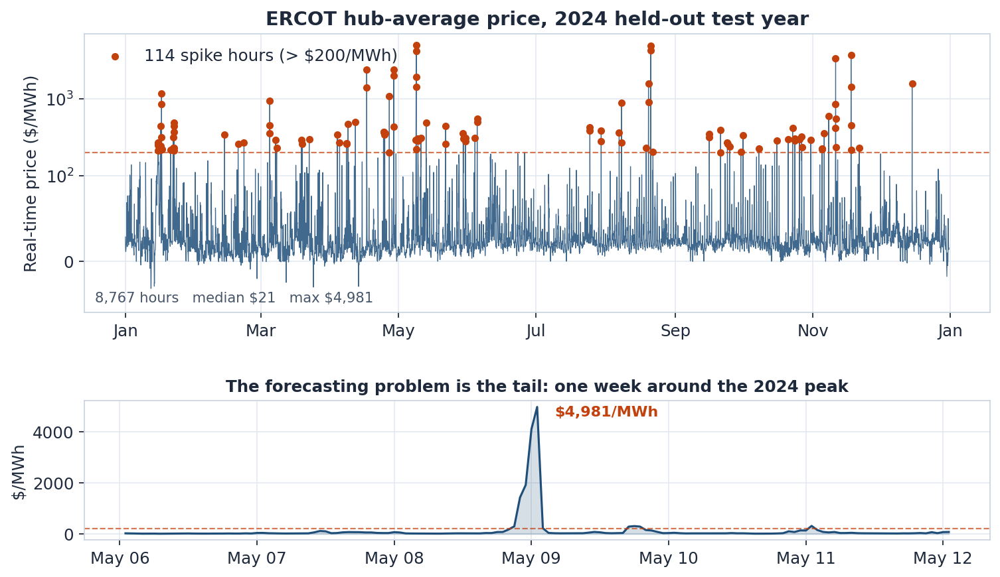
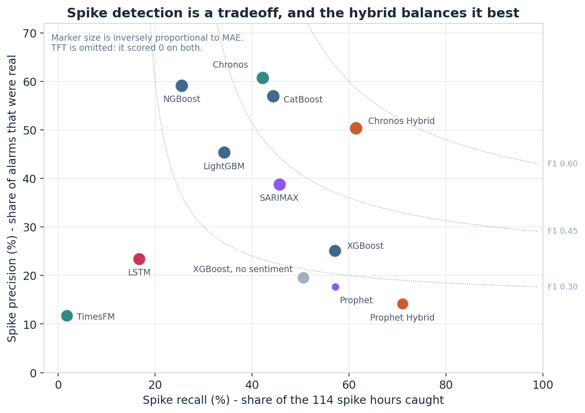
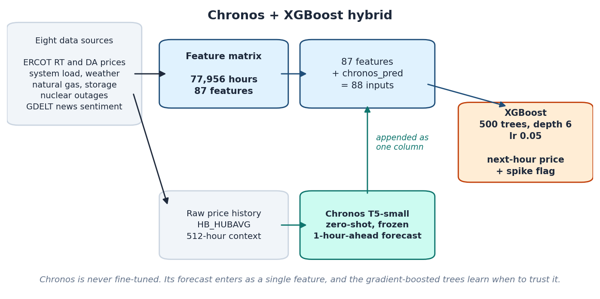
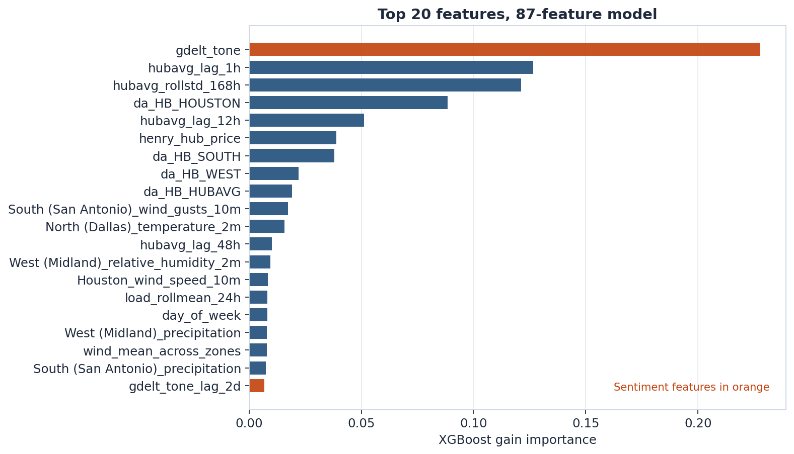
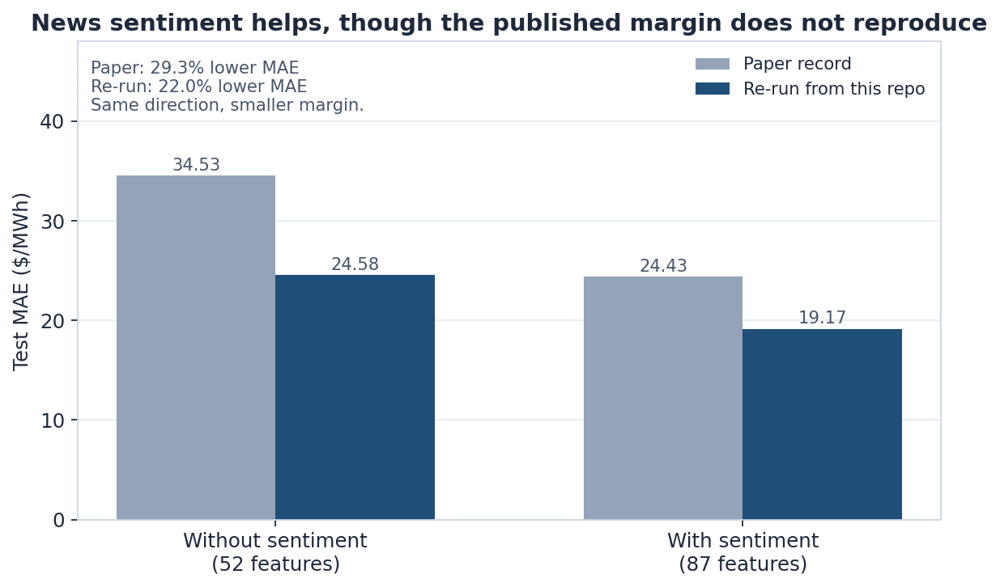

<h1 align="center">A Multimodal Framework for Electricity Price Forecasting<br>Using Sentiment-Augmented Time-Series Signals</h1>

<p align="center">
  <b>Rohan Fozdar</b><br>
  Knox College &middot; Mathematics Capstone
</p>

<p align="center">
  <a href="https://rohanfozdar.github.io/Electricity-Spot-Price-Forecaster/"></a>
  <a href="https://github.com/rohanfozdar/Electricity-Spot-Price-Forecaster/actions/workflows/ci.yml"></a>
  
  <a href="LICENSE"></a>
</p>

<p align="center">
  
</p>

Forecasting the **next-hour ERCOT real-time hub-average price** (`HB_HUBAVG`, $/MWh) and flagging
spikes above **$200/MWh**, using price history, system load, weather, natural gas, nuclear outages,
and GDELT news sentiment.

**[Project page](https://rohanfozdar.github.io/Electricity-Spot-Price-Forecaster/)** &middot;
Paper: coming soon

---

## Abstract

Electricity prices in ERCOT, the Texas grid, are strongly heavy-tailed. Most hours trade near a
median of about **$21/MWh**, while a small number of grid-stress hours run toward the regulatory
cap — the highest hour in this record settled at **$9,052/MWh** — and renewable oversupply can push
prices negative. The economics of the market are therefore set by rare events rather than by typical
conditions.

This project asks whether multimodal signals, and news sentiment in particular, improve next-hour
forecasts of the hub-average price. Eight data sources are assembled into an hourly matrix of
**77,956 observations and 87 engineered features** covering 2016 through 2024, and **13 model
configurations** are benchmarked under one strictly chronological split.

The strongest configuration is neither purely supervised nor purely zero-shot. Feeding a frozen
Chronos forecast into XGBoost as a single extra feature yields **$12.13/MWh MAE with 61.4% spike
recall** on the held-out 2024 test year, ahead of the best standalone supervised model at
$13.75/MWh.

> The core question: can multimodal signals — especially news sentiment — improve electricity price
> forecasting in a market dominated by rare but extreme price spikes?

### Why ERCOT?

ERCOT prices are highly nonlinear and heavy-tailed. Most hours are ordinary, but a small number of
grid-stress events dominate the economics. Over 2016–2024, measured on the matrix in this
repository:

* Median real-time price: **$21/MWh**
* Spike threshold used here: **>$200/MWh**
* Spikes are **1,844 of 77,955 hours**, about **2.4%** of the record
* The highest hour settled at **$9,052/MWh**
* Negative prices occur during renewable oversupply conditions

This makes ERCOT forecasting less about predicting the average hour and more about handling the tail.

---

## Results

All metrics are reported on the held-out **2024 test set** (8,767 hours, 114 of them spike hours).
Spike metrics use `HB_HUBAVG > $200/MWh`.

| Rank | Model                 | Family        |       MAE |      RMSE | Spike Recall | Spike Precision |
| :--: | --------------------- | ------------- | --------: | --------: | -----------: | --------------: |
|   1  | **Chronos Hybrid**    | Hybrid        | **12.13** | **93.98** |       61.40% |          50.43% |
|   2  | **CatBoost**          | GBT           |     13.75 |     95.48 |       44.35% |          56.94% |
|   3  | NGBoost               | GBT           |     14.59 |    106.44 |       25.44% |          59.18% |
|   4  | Chronos               | Foundation    |     14.72 |    115.59 |       42.11% |      **60.76%** |
|   5  | SARIMAX               | Classical     |     18.45 |    124.31 |       45.61% |          38.81% |
|   6  | LightGBM              | GBT           |     19.76 |    100.41 |       34.21% |          45.35% |
|   7  | LSTM                  | Deep Learning |     24.42 |    148.72 |       16.67% |          23.46% |
|   8  | XGBoost               | GBT           |     24.43 |    112.46 |       57.02% |          25.10% |
|   9  | TimesFM               | Foundation    |     32.51 |    136.94 |        1.75% |          11.76% |
|  10  | XGBoost, no sentiment | Ablation      |     34.53 |    122.57 |       50.53% |          19.54% |
|  11  | TFT                   | Deep Learning |     45.75 |    134.60 |        0.00% |           0.00% |
|  12  | Prophet Hybrid        | Hybrid        |     48.36 |    108.96 |   **71.05%** |          14.16% |
|  13  | Prophet               | Classical     |    119.14 |    168.75 |       57.14% |          17.70% |

<p align="center">
  
</p>

The project compares twelve forecasting architectures across five families, plus one no-sentiment
XGBoost ablation:

| Family                      | Models                               |
| --------------------------- | ------------------------------------ |
| Gradient Boosted Trees      | XGBoost, LightGBM, CatBoost, NGBoost |
| Deep Learning               | LSTM, Temporal Fusion Transformer    |
| Zero-Shot Foundation Models | Chronos, TimesFM                     |
| Classical Time Series       | SARIMAX, Prophet                     |
| Hybrid Models               | Chronos + XGBoost, Prophet + XGBoost |
| Ablation                    | XGBoost without sentiment            |

---

## Method

<p align="center">
  
</p>

The hybrid keeps the two halves of the problem separate. **Chronos** (`amazon/chronos-t5-small`)
sees only the raw price series: a 512-hour context window, from which it forecasts one hour ahead.
It is never fine-tuned. That forecast is appended to the 87 engineered features as a column named
`chronos_pred`, and **XGBoost** trains on the 88-column result, learning when the univariate
forecast deserves trust and when weather, outage, gas, and sentiment features should override it.

The pipeline runs in stages:

```text
raw data → hourly feature matrix → model training → benchmark evaluation → dashboard
```

| Folder | Contents |
| --- | --- |
| `pipelines/` | Data ingestion, one script per source |
| `features/` | Feature matrix construction and engineering |
| `models/` | Training scripts, shared utilities, metrics |
| `notebooks/` | Model-specific experiments, one per benchmarked model |
| `evaluation/` | Granger causality, backtests, day-ahead-market benchmark |
| `figures/` | Regenerates every figure on the project page |
| `dashboard/` | Streamlit dashboard |
| `docs/` | The project page, served by GitHub Pages |
| `tests/` | Unit tests |

Files worth knowing about:

| File | Role |
| --- | --- |
| `run_full_pipeline.py` | Stage orchestrator — start here |
| `models/utils.py` | Splits, feature groups, transforms, metrics |
| `models/train_all_v2.py` | Trains every XGBoost regressor and classifier |
| `models/train_chronos_hybrid.py` | The winning model, as a runnable script |
| `features/engineer_v2.py` | Lags, rolling stats, stress flags |

All models use the same chronological split, with no random shuffling:

| Split      |     Years |
| ---------- | --------: |
| Train      | 2016–2022 |
| Validation |      2023 |
| Test       |      2024 |

---

## Key Findings

**1. The best model is not purely supervised or purely zero-shot.** Chronos provides a univariate
temporal forecast; XGBoost combines it with the full physical, market, weather, outage, and
sentiment feature set. Best MAE $12.13/MWh, best RMSE $93.98/MWh.

**2. CatBoost is the best standalone supervised model** at $13.75/MWh MAE and $95.48/MWh RMSE.
Tree-based models handle ERCOT's nonlinear feature interactions better than the deep learning
models tested here.

**3. News sentiment matters.** GDELT tone is the highest-gain single feature in the 87-feature
model, and the XGBoost ablation shows the cost of removing the sentiment family:

| Model                     |   MAE |   RMSE | Spike Recall | Spike Precision |
| ------------------------- | ----: | -----: | -----------: | --------------: |
| XGBoost without sentiment | 34.53 | 122.57 |       50.53% |          19.54% |
| XGBoost with sentiment    | 24.43 | 112.46 |       57.02% |          25.10% |

That is $10.10/MWh, or 29.3%.

> [!NOTE]
> The $34.53 no-sentiment figure does not reproduce when the ablation is re-run
> from this repository — see [Reproducibility](#reproducibility). A like-for-like
> re-run still shows sentiment helping, by 22.0%.

**4. Deep learning underperforms on this dataset.** The LSTM performs reasonably on MAE but misses
most spikes, and the Temporal Fusion Transformer produces zero spike recall on 2024. The issue is
not model capacity alone: ERCOT spike behavior is rare, nonlinear, and event-driven.

**5. Spike prediction is a tradeoff.** Chronos is precise but misses some spikes. Prophet Hybrid
catches many spikes but creates many false alarms. Chronos Hybrid gives the best overall balance.

<p align="center">
  
</p>

---

## Setup

Python 3.9 or newer.

```bash
git clone https://github.com/rohanfozdar/Electricity-Spot-Price-Forecaster.git
cd Electricity-Spot-Price-Forecaster
python -m venv .venv
source .venv/bin/activate
pip install -e .
```

That base install covers the data pipelines, XGBoost, LightGBM, SARIMAX, the figure scripts, the
evaluation scripts and the dashboard. The heavier model families are optional extras, so you only
install what you intend to run:

| Extra | Installs | Needed for |
| --- | --- | --- |
| `.[trees]` | catboost, ngboost | CatBoost, NGBoost notebooks |
| `.[classical]` | prophet, pmdarima | Prophet, SARIMAX notebooks |
| `.[deep]` | torch, pytorch-forecasting, pytorch-lightning | LSTM, TFT |
| `.[foundation]` | chronos-forecasting, transformers, accelerate | Chronos, **Chronos hybrid** |
| `.[all]` | everything above | the full bake-off |

```bash
pip install -e ".[foundation]"   # to reproduce the winning model
```

An API key is only needed to **re-pull raw data**. Every model runs off the committed feature matrix
without one:

```bash
cp .env.example .env        # then add your free EIA key if re-pulling
```

---

## What ships in the repo, and what you regenerate

This trips people up, so it is worth stating plainly. The repository commits exactly one data file,
and it is the one every model reads:

| Path | In git? | How to get it |
| --- | :---: | --- |
| `data/features/feature_matrix_engineered_v2.parquet` | **yes** (9.9 MB) | ships — 77,956 x 95, the canonical matrix |
| `docs/static/images/*.png` | **yes** | regenerate with `python figures/make_figures.py` |
| `evaluation/*_results.json` | yes | regenerate with `--stage evaluate` |
| `data/raw/*.parquet` | no | `python run_full_pipeline.py --stage pipelines` (needs an EIA key) |
| `data/features/feature_matrix_raw_v2.parquet` | no | `python run_full_pipeline.py --stage features` |
| `models/artifacts/*` | no | `python run_full_pipeline.py --stage models` |

So a fresh clone can train and evaluate every model immediately. Only re-deriving the matrix from
primary sources needs the raw pull.

---

## Usage

The orchestrator runs in stages. Each depends on the one before it:

```bash
python run_full_pipeline.py --stage models      # train (works on a fresh clone)
python run_full_pipeline.py --stage evaluate    # Granger, backtest, DAM benchmark
python run_full_pipeline.py --stage dashboard   # Streamlit
```

```bash
python run_full_pipeline.py --stage pipelines   # re-pull raw sources (needs EIA key)
python run_full_pipeline.py --stage features    # rebuild the matrix from raw
```

`--stage features` and `--stage pipelines` skip with an explanatory message if `data/raw/` is empty,
rather than failing.

### Reproducing the winning model

The Chronos hybrid is the headline result, and it has its own script:

```bash
pip install -e ".[foundation]"
python models/train_chronos_hybrid.py
```

Read the runtime warning below before starting it, and see **[GPU_RUN.md](GPU_RUN.md)** for
step-by-step instructions on a GPU machine or cluster.

### Regenerating the figures

Every figure on the project page and in this README is generated from the committed matrix:

```bash
python figures/make_figures.py            # all figures
python figures/make_figures.py --list     # names
python figures/make_figures.py --only teaser
```

`feature_importance.png` additionally needs `--stage models` to have been run, since it reads a
model artifact. The script says so and skips that one figure rather than failing.

### Individual models

Each notebook is self-contained and reads the committed matrix:

```bash
jupyter lab "notebooks/06_catboost (1).ipynb"
```

| Notebook | Model | Extra required |
| --- | --- | --- |
| `02_v2_models.ipynb` | XGBoost + ablation | base |
| `05_lightgbm.ipynb` | LightGBM | base |
| `06_catboost (1).ipynb` | CatBoost | `.[trees]` |
| `07_ngboost.ipynb` | NGBoost | `.[trees]` |
| `08_lstm.ipynb` | LSTM | `.[deep]` |
| `09_tft.ipynb` | Temporal Fusion Transformer | `.[deep]` |
| `10_chronos (1).ipynb` | Chronos + **Chronos hybrid** | `.[foundation]` |
| `12_timesfm.ipynb` | TimesFM | `.[deep]` + `timesfm` |
| `13_prophet.ipynb` | Prophet + Prophet hybrid | `.[classical]` |
| `14_sarimax.ipynb` | SARIMAX | `.[classical]` |

---

## Reproducibility

The leaderboard above is the record from the capstone paper. The tables here report what the
training scripts in this repository produce when re-run today, so you can tell at a glance which
numbers are the published result and which are a live re-run.

**Re-run on 2026-09-05** (`python run_full_pipeline.py --stage models`, XGBoost regressors on the
committed v2 matrix):

| Model | Features | MAE | RMSE | Spike recall | Spike precision |
| --- | ---: | ---: | ---: | ---: | ---: |
| `baseline_v2` — no sentiment | 52 | 24.58 | 117.76 | 53.51% | 24.90% |
| `enhanced_v2` — with sentiment | 87 | **19.17** | **108.59** | 42.98% | 33.33% |

Both are trained by the same function (`models/train_all_v2.py:_train_regressor`) with identical
hyperparameters, so the only difference between them is the feature set. That makes it a clean
ablation:

```text
sentiment reduces MAE by $5.42/MWh, or 22.0%
```

<p align="center">
  
</p>

### Known discrepancy in the sentiment ablation

Key Finding #3 above cites $34.53 vs $24.43, a 29.3% reduction. **The $34.53 no-sentiment figure
does not reproduce from this codebase.** Re-running the ablation four ways — v1 and v2 matrices,
with and without the log1p transforms — puts the no-sentiment MAE between $22.17 and $24.58 every
time; nothing lands near $34.53.

The paper's *conclusion* holds: on a like-for-like comparison sentiment reduces MAE by 22.0%, which
is the same direction and a similar magnitude. But the specific pair of numbers in the leaderboard
should be treated as the paper's record rather than something you can regenerate by running this
repository.

### The headline hybrid number is also the paper's record

The Chronos backfill needed for the hybrid is roughly 77,400 forward passes, and it has not been
completed end-to-end on the machine used to prepare this release. `models/train_chronos_hybrid.py`
is the script that reproduces it, it checkpoints and resumes, and
[GPU_RUN.md](GPU_RUN.md) walks through running it on a GPU. Until that run finishes, treat
$12.13/MWh as the published figure rather than a number this repository has regenerated.

### What was and was not re-executed

Seven configurations — CatBoost, NGBoost, LSTM, TFT, TimesFM, Prophet and SARIMAX — were verified by
code inspection rather than re-executed for this release, and the runtime table below is
approximate. The Streamlit dashboard has been repaired by inspection but has not been observed
rendering.

### One pipeline, applied consistently

The model notebooks apply `models/utils.py:apply_feature_transforms` (log1p over 34 heavily
right-skewed columns) before training; the scripts in `models/` originally did not. The same model
therefore produced different numbers depending on whether you ran the notebook or the script.

The scripts now apply the same transform, so both paths sit on one pipeline. If you are comparing
against an older artifact, that change is the reason the numbers moved.

---

## Runtime and hardware

> [!WARNING]
> **The Chronos backfill is by far the slowest step in this project.** The hybrid needs a
> one-hour-ahead Chronos forecast for *every* hourly observation, which is about **77,400 forward
> passes** of `amazon/chronos-t5-small` over a 512-hour context. Budget **30-60 minutes on an NVIDIA
> GPU**, roughly **70 minutes on Apple MPS**, and **many hours on a CPU-only machine**. A GPU is
> strongly recommended.
>
> `models/train_chronos_hybrid.py` checkpoints to `data/features/chronos_pred.parquet` every 20
> batches, so an interrupted run resumes instead of restarting. Re-running the script is always safe.

Approximate wall-clock on the 2016-2024 matrix:

| Model | GPU | CPU | Notes |
| --- | --- | --- | --- |
| XGBoost, LightGBM, CatBoost, NGBoost | n/a | 1-5 min | CPU is fine; no GPU benefit |
| Prophet / Prophet hybrid | n/a | 5-15 min | CPU only |
| SARIMAX | n/a | 30-90 min | `auto_arima` search; **no GPU benefit** |
| LSTM | 5-15 min | 1-3 h | **GPU recommended** |
| TFT | 10-20 min | 2-4 h | **GPU recommended** |
| TimesFM | 20-40 min | several hours | **GPU strongly recommended** |
| **Chronos hybrid** | **30-60 min** | **many hours** | **GPU strongly recommended**; resumable |

Memory notes:

- On Apple MPS, keep `--batch-size` at 32 or below. Batch 64 exhausts a 20 GB MPS pool partway
  through the backfill. The script catches the OOM, checkpoints, and tells you what to re-run.
- The deep-learning notebooks fall back to CPU automatically when CUDA is unavailable, so they run
  anywhere — just slowly.

---

## Paper

This repository supports the paper:

**A Multimodal Framework for Electricity Price Forecasting Using Sentiment-Augmented Time-Series
Signals**

The paper contains the full methodology, feature construction details, model descriptions, and
discussion of results. It is not yet posted; when it is, the PDF will be linked from the
[project page](https://rohanfozdar.github.io/Electricity-Spot-Price-Forecaster/).

## Citation

```bibtex
@misc{fozdar2026multimodal,
  title  = {A Multimodal Framework for Electricity Price Forecasting Using
            Sentiment-Augmented Time-Series Signals},
  author = {Fozdar, Rohan},
  year   = {2026},
  note   = {Mathematics Capstone, Knox College},
  url    = {https://rohanfozdar.github.io/Electricity-Spot-Price-Forecaster/}
}
```

## License

Code in this repository is released under the [MIT License](LICENSE). The project page under
`docs/` is built on the
[Academic Project Page Template](https://github.com/eliahuhorwitz/Academic-project-page-template),
which derives from [Nerfies](https://nerfies.github.io) and is licensed
[CC BY-SA 4.0](http://creativecommons.org/licenses/by-sa/4.0/).

Data remains the property of its providers: ERCOT, the EIA, Open-Meteo, the NRC, and GDELT.

## Acknowledgments

Built with [Chronos](https://github.com/amazon-science/chronos-forecasting) from Amazon Science,
[XGBoost](https://github.com/dmlc/xgboost), and public data from ERCOT, the U.S. Energy Information
Administration, Open-Meteo, the Nuclear Regulatory Commission, and the GDELT Project.

---

<p align="center">
  <b>Rohan Fozdar</b> &middot; Knox College &middot; Mathematics Capstone Project
</p>
