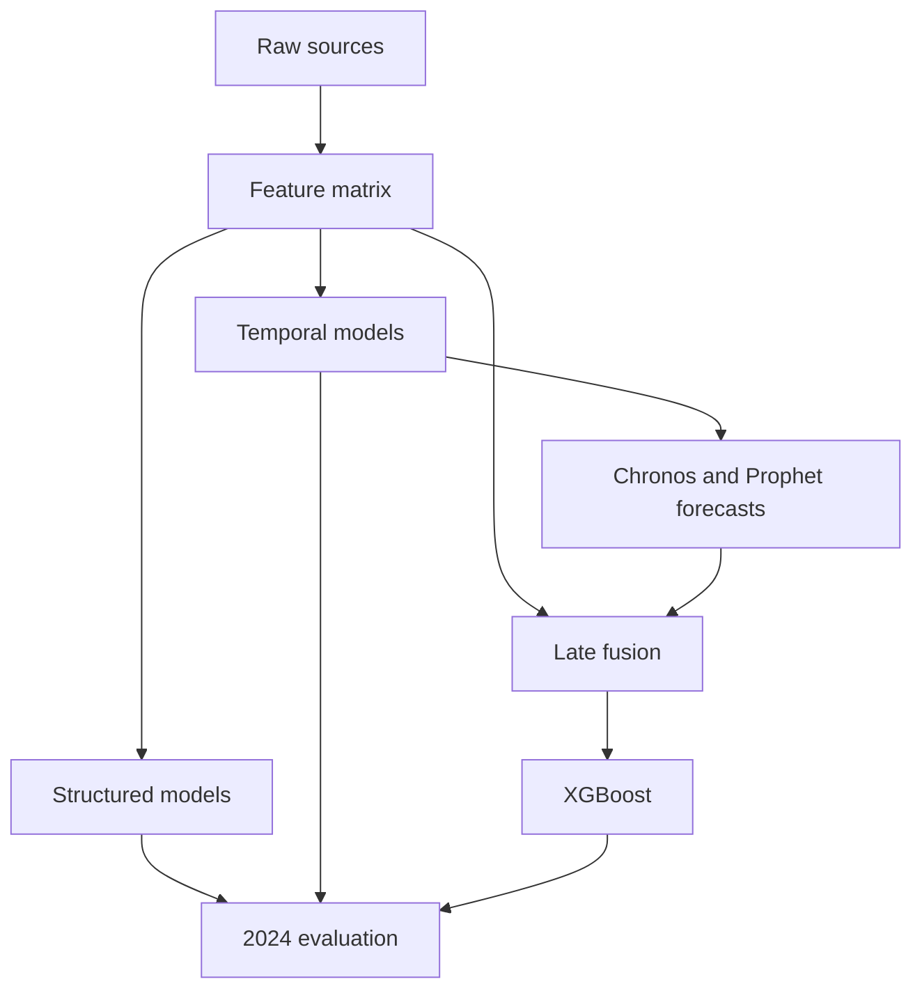

# ERCOT Electricity Price Forecasting

A multimodal benchmark of classical, machine-learning, deep-learning, foundation, and hybrid models for retrospective ERCOT electricity-price estimation and spike detection.

[](pyproject.toml)
[](LICENSE)

ERCOT · 2016–2024 · 12 configurations · Manuscript in preparation

## Overview

The benchmark estimates the hourly ERCOT real-time hub-average price (`HB_HUBAVG`, $/MWh) and flags hours above $200/MWh. The sample is an engineered matrix of 77,956 hours from 2016 through 2024, built from real-time and day-ahead prices, load, Open-Meteo reanalysis, EIA natural gas and storage, NRC reactor status, GDELT news, and calendar variables. Some same-hour archived market variables and historical reanalysis remain in that matrix, so the executed experiments are retrospective hourly price estimation and spike detection. Next-hour forecasting is the intended operational extension; it needs a point-in-time feature lag that this benchmark does not apply.

The comparison asks whether a frozen univariate forecast from a pretrained temporal model complements those ERCOT-specific covariates. Twelve configurations span structured machine learning, deep sequence models, foundation models, classical time-series models, and late-fusion hybrids. The chronological split is 2016–2022 train, 2023 validation, and 2024 test.



## Model Taxonomy

| Model | Family | Information | Regime | Paper | Code |
| --- | --- | --- | --- | --- | --- |
| XGBoost | Structured ML | Multimodal covariates | Supervised | [Chen and Guestrin 2016](https://arxiv.org/abs/1603.02754) | [01_xgboost.ipynb](notebooks/01_xgboost.ipynb) |
| LightGBM | Structured ML | Multimodal covariates | Supervised | [Ke et al. 2017](https://proceedings.neurips.cc/paper/2017/hash/6449f44a102fde848669bdd9eb6b76fa-Abstract.html) | [02_lightgbm.ipynb](notebooks/02_lightgbm.ipynb) |
| CatBoost | Structured ML | Multimodal covariates | Supervised | [Prokhorenkova et al. 2018](https://arxiv.org/abs/1706.09516) | [03_catboost.ipynb](notebooks/03_catboost.ipynb) |
| NGBoost | Structured ML | Multimodal covariates | Supervised | [Duan et al. 2020](https://arxiv.org/abs/1910.03225) | [04_ngboost.ipynb](notebooks/04_ngboost.ipynb) |
| LSTM | Deep Sequence | Multivariate sequence | Supervised | [Hochreiter and Schmidhuber 1997](https://doi.org/10.1162/neco.1997.9.8.1735) | [05_lstm.ipynb](notebooks/05_lstm.ipynb) |
| Temporal Fusion Transformer | Deep Sequence | Multivariate sequence | Supervised | [Lim et al. 2021](https://arxiv.org/abs/1912.09363) | [06_tft.ipynb](notebooks/06_tft.ipynb) |
| Chronos | Foundation | Price history | Zero-shot | [Ansari et al. 2024](https://arxiv.org/abs/2403.07815) | [07_chronos_and_hybrid.ipynb](notebooks/07_chronos_and_hybrid.ipynb) |
| TimesFM | Foundation | Price history | Zero-shot | [Das et al. 2024](https://arxiv.org/abs/2310.10688) | [08_timesfm.ipynb](notebooks/08_timesfm.ipynb) |
| SARIMAX | Classical | Price history + statistical structure | Series-specific | [Box, Jenkins, Reinsel, and Ljung](https://doi.org/10.1002/9781118619193) | [10_sarimax.ipynb](notebooks/10_sarimax.ipynb) |
| Prophet | Classical | Price history + statistical structure | Series-specific | [Taylor and Letham 2018](https://doi.org/10.1080/00031305.2017.1380080) | [09_prophet_and_hybrid.ipynb](notebooks/09_prophet_and_hybrid.ipynb) |
| Chronos–XGBoost | Hybrid | Foundation forecast + multimodal covariates | Late fusion | [Ansari et al. 2024](https://arxiv.org/abs/2403.07815); [Chen and Guestrin 2016](https://arxiv.org/abs/1603.02754) | [07_chronos_and_hybrid.ipynb](notebooks/07_chronos_and_hybrid.ipynb) |
| Prophet–XGBoost | Hybrid | Statistical forecast + multimodal covariates | Late fusion | [Taylor and Letham 2018](https://doi.org/10.1080/00031305.2017.1380080); [Chen and Guestrin 2016](https://arxiv.org/abs/1603.02754) | [09_prophet_and_hybrid.ipynb](notebooks/09_prophet_and_hybrid.ipynb) |

Chronos–XGBoost and Prophet–XGBoost are sections of the Chronos and Prophet notebooks, not separate files. The experiment index is [notebooks/README.md](notebooks/README.md).

## Benchmark

Reported consolidated project benchmark on the 2024 test year. Spike metrics use `HB_HUBAVG > $200/MWh`.

| Model | Family | MAE | RMSE | Spike recall | Spike precision |
| --- | --- | ---: | ---: | ---: | ---: |
| Chronos–XGBoost | Hybrid | 12.13 | 93.98 | 61.40% | 50.43% |
| CatBoost | Structured ML | 13.75 | 95.48 | 44.35% | 56.94% |
| NGBoost | Structured ML | 14.59 | 106.44 | 25.44% | 59.18% |
| Chronos | Foundation | 14.72 | 115.59 | 42.11% | 60.76% |
| SARIMAX | Classical | 18.45 | 124.31 | 45.61% | 38.81% |
| LightGBM | Structured ML | 19.76 | 100.41 | 34.21% | 45.35% |
| LSTM | Deep Sequence | 24.42 | 148.72 | 16.67% | 23.46% |
| XGBoost | Structured ML | 24.43 | 112.46 | 57.02% | 25.10% |
| TimesFM | Foundation | 32.51 | 136.94 | 1.75% | 11.76% |
| TFT | Deep Sequence | 45.75 | 134.60 | 0% | 0% |
| Prophet–XGBoost | Hybrid | 48.36 | 108.96 | 71.05% | 14.16% |
| Prophet | Classical | 119.14 | 168.75 | 57.14% | 17.70% |

1. The consolidated project benchmark reports Chronos–XGBoost as the lowest-error configuration.
2. Standalone Chronos has high precision, while XGBoost has higher recall; the hybrid reports a stronger balance.
3. Prophet–XGBoost reaches high recall but creates a large false-positive burden.

Aggregate benchmark values come from the project's consolidated comparison, recorded in the capstone PDF ([docs/static/pdfs/paper.pdf](docs/static/pdfs/paper.pdf)) and in `figures/make_figures.py` (`PAPER_LEADERBOARD`). They were produced across multiple experiment versions. The matched GDELT ablation below has preserved executed output in [notebooks/01_xgboost.ipynb](notebooks/01_xgboost.ipynb); a common frozen rerun is still required for a strict cross-model leaderboard. Saved notebook outputs agree with the LightGBM row and differ for several other models. The [notebook index](notebooks/README.md) records which outputs exist.

## GDELT Ablation

Matched XGBoost comparison from the saved output of [notebooks/01_xgboost.ipynb](notebooks/01_xgboost.ipynb): same transforms, split, hyperparameters, and target, with the GDELT columns removed. An earlier consolidated row reported MAE 34.53 without sentiment and 24.43 with sentiment. That pair is a different comparison. A script re-run of `models/train_all_v2.py` reported MAE 24.58 without the sentiment block and 19.17 with the enhanced feature set. Neither pair is the ablation below.

| Setting | MAE | RMSE | Spike recall | Spike precision | PR-AUC |
| --- | ---: | ---: | ---: | ---: | ---: |
| Without GDELT | 24.64 | 114.20 | 57.89% | 24.81% | 0.400 |
| With GDELT | 22.21 | 108.88 | 54.39% | 30.24% | 0.422 |

Adding GDELT features reduces MAE by 9.9% and improves precision and PR-AUC, while recall decreases slightly.

## Data

The engineered matrix has 77,956 hourly observations from 2016 through 2024 (`data/features/feature_matrix_engineered_v2.parquet`).

| Source | Variables | Frequency | Role |
| --- | --- | --- | --- |
| ERCOT real-time | Hub settlement prices, including `HB_HUBAVG` | 15-minute, aggregated hourly | Target and price history |
| ERCOT day-ahead | Hub settlement prices | Hourly | Market covariate |
| ERCOT / EIA load | System load | Hourly | Demand covariate |
| Open-Meteo | Temperature, wind, humidity, cloud cover, precipitation | Hourly | Weather reanalysis |
| EIA natural gas | Henry Hub spot price | Daily | Fuel price |
| EIA storage | Lower 48 working gas | Weekly | Fuel balance |
| NRC reactor status | Capacity factor for ERCOT reactors | Daily | Outage covariate |
| GDELT | Article tone and volume | Daily | News covariate |
| Calendar variables | Hour, day of week, month, weekend, peak flag | Hourly | Seasonal structure |

`data/raw/` is gitignored. Re-pulling primary sources requires an EIA key in `.env` (see `.env.example`). The committed matrix is enough to open the benchmark notebooks.

## Repository

Two experiments share this repository. The benchmark notebooks and `models/` score the hourly matrix. `src/` is a separate six-hour-ahead early-warning pipeline and is not the source of the tables below.

```text
.
├── pipelines/                 # Source ingestion
├── features/                  # v1 and v2 matrix construction
├── models/                    # Benchmark training and the frozen 2024 protocol
│   ├── train_all_v2.py
│   ├── train_chronos_hybrid.py
│   ├── run_benchmark.py       # Paper-row reruns and the leaderboard writer
│   ├── improve_hybrid.py      # Validation search over the hybrid
│   ├── honest_mae.py          # One-hour-ahead protocol; 2024 scored once
│   └── chronos_hourly_features.py
├── notebooks/                 # Benchmark experiments, numbered 01–10
├── evaluation/                # Granger tests, backtests, day-ahead benchmark
├── dashboard/                 # Streamlit view of the v2 XGBoost artifacts
├── figures/                   # Figures for the project page
├── src/                       # Point-in-time early-warning experiment
├── configs/                   # Feature-availability and experiment rules
├── scripts/                   # Audit, Chronos caches, early-warning runner
├── reports/
│   ├── reproduction.md        # What the paper rows do and do not reproduce
│   ├── honest_mae.md          # Frozen one-hour-ahead scores
│   ├── repository_audit.md
│   └── experiment_design.md
├── data/
│   ├── raw/                   # Gitignored primary pulls
│   └── features/              # Committed v2 matrix
├── tests/
├── docs/                      # Project page; capstone PDF under docs/static/pdfs/
├── run_full_pipeline.py       # Ingest, features, XGBoost scripts, evaluation
├── run_pipeline.py            # Real-time and day-ahead price pulls only
└── README.md
```

The canonical artifact for the benchmark is the v2 matrix. Notebooks, `models/train_all_v2.py`, and `dashboard/app.py` read `data/features/feature_matrix_engineered_v2.parquet` and, for the dashboard, `models/artifacts/enhanced_v2_*`. `run_full_pipeline.py` builds that matrix when `data/raw/` is present. The v1 builders stay available behind `BUILD_V1_MATRIX=1` and are off the default path. Prediction files and fitted boosters live under `runs/`, which is gitignored. The write-ups in `reports/` are the durable record.

## Setup

```bash
python -m venv .venv
source .venv/bin/activate
pip install -e .
```

The base install covers pipelines, the XGBoost scripts, LightGBM, SARIMAX via statsmodels, evaluation, and the dashboard. Other families are extras:

| Extra | Needed for |
| --- | --- |
| `.[trees]` | CatBoost, NGBoost |
| `.[classical]` | Prophet, `pmdarima` order search |
| `.[deep]` | LSTM, TFT |
| `.[foundation]` | Chronos and `models/train_chronos_hybrid.py` |
| `.[all]` | Every extra above |

Two entry points:

```bash
python run_full_pipeline.py --stage models
```

That command trains the XGBoost script family (baseline, enhanced, classifiers, and the v2 bundle). It does not train or score the twelve benchmark configurations. Those live in the notebooks. `--stage evaluate` runs Granger tests, the stress-event backtest, and the day-ahead benchmark. `--stage pipelines` and `--stage features` re-pull and rebuild the matrix; both skip with a message when `data/raw/` is empty. `--stage dashboard` launches Streamlit.

```bash
jupyter lab notebooks/01_xgboost.ipynb
```

Open one notebook per configuration. Install the extra for that family first. Chronos backfill and the deep-sequence notebooks are the slow steps; [GPU_RUN.md](GPU_RUN.md) covers the Chronos hybrid script. The hybrid cells in the Chronos and Prophet notebooks were not executed in the saved notebooks.

## Paper

**A Multimodal Benchmark of Classical, Machine Learning, and Foundation Models for ERCOT Electricity Price Forecasting**

The manuscript benchmarks twelve forecasting configurations and studies whether pretrained temporal forecasts complement ERCOT-specific structured covariates.

Manuscript in preparation.

An earlier capstone PDF, under a different title, is at [docs/static/pdfs/paper.pdf](docs/static/pdfs/paper.pdf). The consolidated table above is the comparison recorded there.

## Reproducibility

A frozen rerun of the headline rows is written up in [reports/reproduction.md](reports/reproduction.md). The 2024 test index is 8,767 hours and 114 spikes, hash `b850034b0690e660`. Choices were made on 2023 only. The tables above are the paper's reported numbers and are unchanged.

On this Linux host, with XGBoost 2.1.4 and Chronos-T5 small:

- Chronos zero-shot lands at MAE 14.54 (paper 14.72). Three more sampling seeds span 14.56–14.89.
- The day-ahead price row matches the paper on MAE, RMSE, spike recall, and spike precision.
- The notebook-faithful Chronos–XGBoost hybrid lands at MAE 21.96, RMSE 112.83, spike recall 58.77%, spike precision 30.45% (paper 12.13 / 93.98 / 61.40% / 50.43%). A validation-only search, scored once on 2024 over five seeds, reaches MAE 13.06 ± 0.17 and precision 70.9% ± 3.3, with RMSE 107.18 and recall 38.1%. The Chronos–XGBoost and CatBoost recall/precision pairs in the table above are not integer ratios on 114 spikes, so they cannot be matched exactly.
- The 24-hour alert, with the calibrator and threshold chosen on 2023, scores recall 43.10%, precision 24.63%, F1 31.01% (paper 34.63% / 24.22% / 28.50%). Lead times for the seven spike events are in the report.

Prediction vectors and `runs/benchmark/leaderboard.md` are produced by `python models/run_benchmark.py leaderboard`. The `runs/` directory is gitignored.

## One-hour-ahead protocol

`models/honest_mae.py` keeps the selected Chronos–XGBoost hyperparameters (gap-aware Chronos-T5, asinh target, absolute-error XGBoost, depth 6, learning rate 0.05, seed 42) and changes the information set and the training window. Weather and the weather stress flags are lagged one hour. The gas-spike flag uses the pre-2023 90th percentile. GDELT is dropped. New columns are the previous hour's 15-minute price summaries and the day-ahead shape (ramp, operating-day max and min, trailing real-time minus day-ahead spread). The training window, 2019–2022, is the length with the lowest MAE on 2022. Early stopping uses 2023. The 2024 year is not used to choose a window, a penalty, or a weight.

The full write-up is [reports/honest_mae.md](reports/honest_mae.md). On the frozen 2024 index:

| Run | MAE | RMSE | Spike recall | Spike precision |
| --- | ---: | ---: | ---: | ---: |
| Windowed tree | 11.56 | 99.96 | 50.00% | 73.08% |
| 2023 quantile stack | 12.13 | 96.23 | 53.51% | 64.21% |
| Same hyperparameters, original features | 12.95 | 104.13 | 42.11% | 69.57% |

The paper table above is unchanged. The stack's MAE prints as 12.13 with a different RMSE and a different spike pair, so it is not the paper row. Both new scores are one seed.

```bash
python models/honest_mae.py check   # rewrite the report from saved predictions
python models/honest_mae.py all     # run the protocol; existing predictions are left alone
pytest tests/test_honest_mae.py
```

## Citation

```bibtex
@misc{fozdar2026ercot,
  author = {Fozdar, Rohan},
  title = {A Multimodal Benchmark of Classical, Machine Learning, and Foundation Models for ERCOT Electricity Price Forecasting},
  year = {2026},
  howpublished = {\url{https://github.com/rohanfozdar/Electricity-Price-Forecaster}}
}
```

## License

Code is released under the [MIT License](LICENSE). Data remains the property of ERCOT, the EIA, Open-Meteo, the NRC, and GDELT. The project page under `docs/` is built on the [Academic Project Page Template](https://github.com/eliahuhorwitz/Academic-project-page-template).
